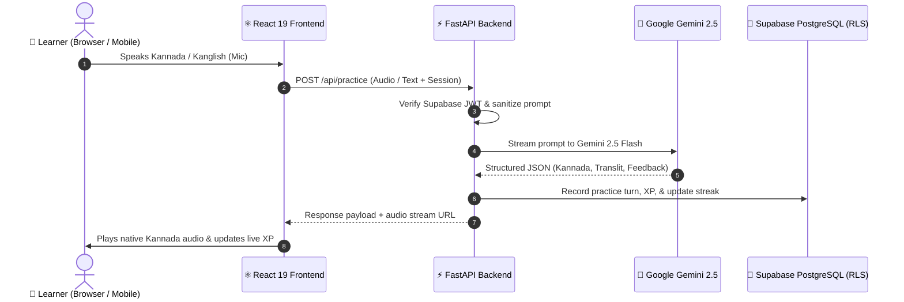

# ಮಾತು (MAATHU) — VOICE OF KANNADA
> **"Don't just learn Kannada. Live, speak, think, and communicate in Kannada."**  
> *"ಕನ್ನಡ ಕಲಿಯೋಣ, ಆತ್ಮವಿಶ್ವಾಸದಿಂದ ಮಾತನಾಡೋಣ"*

[](https://github.com/amanbapunavar17/voice-of-kannada/actions/workflows/ci.yml)
[](https://react.dev/)
[](https://fastapi.tiangolo.com/)
[](https://ai.google.dev/)
[](https://supabase.com/)
[](LICENSE)

---

## 🌐 Live Deployments & Repository Links

| Component | Target Platform | Live Production URL |
| :--- | :--- | :--- |
| **Frontend Web App** | **GitHub Pages** | **[https://amanbapunavar17.github.io/voice-of-kannada/](https://amanbapunavar17.github.io/voice-of-kannada/)** |
| **Frontend Mirror** | **Vercel** | Ready with zero-config `vercel.json` |
| **Backend API** | **FastAPI / Render** | Blueprint ready via `render.yaml` & `Dockerfile` |
| **GitHub Source** | **GitHub Repository** | **[https://github.com/amanbapunavar17/voice-of-kannada](https://github.com/amanbapunavar17/voice-of-kannada)** |

---

## 📌 Executive Summary & Product Vision

Moving to Karnataka for college or tech careers often presents an unspoken barrier: **conversational confidence**. While traditional language apps teach isolated flashcards and rigid grammar drills, newcomers struggle with everyday realities:
- Negotiating fares with auto drivers (*"Meter haaki sir!"*)
- Ordering filter coffee and dosas at local Darshinis (*"Ondu plate masala dose, benne jasti!"*)
- Conversing with BMTC bus conductors (*"Majestic-ge ticket kodi"*).

**MAATHU (ಮಾತು)** transforms passive memorization into **active conversational fluency**. Powered by **Google Gemini 2.5**, **FastAPI**, **React 19**, and **Supabase**, MAATHU is a voice-first, culturally authentic Kannada learning ecosystem that listens, speaks, coaches pronunciation, and rewards learners for every word spoken.

---

## 🌟 The 6 Signature Features

```
┌────────────────────────────────────────────────────────────────────────┐
│                        MAATHU CORE ARCHITECTURE                        │
├─────────────────────┬─────────────────────┬────────────────────────────┤
│ 🎙️ 1. AI Real-Time  │ 🗣️ 2. Pronunciation │ 📷 3. Computer Vision      │
│    Conversation     │    Intelligence     │    Object Scanner          │
│ (Voice, Kanglish,   │ (Acoustic diff,     │ (Gemini Multimodal,        │
│  3 learning modes)  │  Native TTS audio)  │  instant vocabulary)       │
├─────────────────────┼─────────────────────┼────────────────────────────┤
│ 🎭 4. Real-World    │ 🗺️ 5. Regional      │ 📓 6. Mistake Notebook     │
│    Missions         │    Dialects         │    & Gamification          │
│ (BMTC, Darshini,    │ (Mysore, Karavali,  │ (XP, Points, Streaks,      │
│  Auto, Market)      │  Hubballi, Malnad)  │  Verifiable Certificates)  │
└─────────────────────┴─────────────────────┴────────────────────────────┘
```

### 1. 🎙️ AI Real-Time Kannada Conversation (Companion Mode)
- **Bi-directional voice & text**: Speak naturally using your microphone with seamless Kanglish (Kannada written in Latin script) or native Kannada script.
- **Context-aware companion**: Powered by Gemini 2.5 with persona memory that asks natural follow-up questions instead of cold literal translations.
- **3 Adaptive Modes**:
  - *Beginner Mode*: Slower speech, supportive explanations, and suggested reply chips.
  - *Intermediate Mode*: Natural colloquial Kannada with contextual vocabulary hints.
  - *Challenge Mode*: Rapid native speech and unassisted real-world responses.
- **Context-Sensitive Feedback**: Summarizes speaker intent, offers natural native phrasings, highlights mistakes gently, and suggests retries.

### 2. 🗣️ Pronunciation Intelligence Studio
- **Acoustic and phonetic evaluation**: Compares learner voice recordings against standard Kannada phonetic models.
- **3-Tier Audio Fallback Cascade**:
  1. High-fidelity native Google Kannada MP3 stream (`/api/tts?text=...&lang=kn`).
  2. Direct cloud speech synthesis fallback.
  3. Browser Web Speech API (`kn-IN`).
- **Word-Level Analysis**: Visual color-coded diff of words pronounced correctly, partially matching, or missed, accompanied by actionable articulation tips.

### 3. 📷 Computer Vision Real-World Object Scanner
- **Point and Learn**: Capture or upload photos of everyday objects, street signs, vegetables, or office items using your device camera.
- **Gemini Multimodal Recognition**: Identifies the item, returns the exact Kannada script (*e.g., 'ಬೆಂಡೆಕಾಯಿ - Bendekaayi'*), phonetic transliteration, grammatical category, example sentences, and audio pronunciation.

### 4. 🎭 Real-World Scenario Missions
Interactive multi-turn simulation missions graded dynamically:
1. **Auto Driver Negotiation**: Ask to turn on the meter and give landmarks (*"Indiranagar 100ft road-ge hogbeku"*).
2. **Darshini Tiffin Room**: Order breakfast, ask for extra chutney, and settle the UPI bill.
3. **BMTC Bus Conductor**: Buy tickets to Majestic, ask for change (*"Chillar kodi"*), and confirm the stop.
4. **Commercial Street Bargaining**: Negotiate cloth and footwear prices with local shopkeepers.
5. **Tech Park Water Cooler**: Casual Kannada networking with colleagues.
6. **Directions in Central Bengaluru**: Ask for navigation towards Vidhana Soudha and Cubbon Park.

### 5. 🗺️ Regional Dialects Explorer
Karnataka's beauty lies in its regional linguistic diversity. MAATHU introduces authentic variations:
- **Old Mysore (ಹಳೆ ಮೈಸೂರು)**: Standard cultural Kannada spoken across Bengaluru and Mysuru.
- **North Karnataka / Hubballi-Dharwad (ಉತ್ತರ ಕರ್ನಾಟಕ)**: Affectionate, energetic phrasing (*"ಏನ್ ಮಾಡ್ಲಿಕ್ಕತ್ತೀರಿ?", "ಬರ್ರಿ"*).
- **Coastal / Karavali (ಕರಾವಳಿ)**: Mangaluru & Udupi coastal Kannada infused with Tulu cadence.
- **Malnad (ಮಲೆನಾಡು)**: Western Ghats rain-country dialect with traditional warmth.
- **Hyderabad-Karnataka / Kalyana Karnataka (ಕಲ್ಯಾಣ ಕರ್ನಾಟಕ)**: Kalaburagi & Bidar regional expressions.

### 6. 📓 Personal Mistake Notebook & Dual-Economy Gamification
- **Intelligent Error Ledger**: Automatically captures pronunciation slips, vocabulary confusions, and grammatical gaps during chat sessions for targeted practice.
- **Dual Economy**:
  - **XP (Experience Points)**: Unlocks badges and moves learners from *Explorer* to *Karnataka Champion*.
  - **Maatu Points**: Redeemable credits for cultural merchandise in the Goodies Store.
- **Verifiable PDF Certificates**: Dynamic A4 landscape credentials generated via `jsPDF` with tamper-evident serial numbers and public API verification (`/api/verify-certificate/{cert_id}`).

---

## 🏛️ Karnataka Heritage Design System

MAATHU's interface celebrates Karnataka's art, architecture, and geography:
- **Forest Green (`#174B3A`)**: Inspired by the lush Western Ghats and Bandipur reserves.
- **Temple Gold (`#D4A64A` / `#FFD700`)**: Emulating Hoysala and Chalukya temple carvings.
- **Heritage Cream (`#FAF7F0`)**: Warm parchment tone for readable, strain-free typography.
- **Bilingual Font Stack**: Clean system Latin font paired with `Noto Sans Kannada` for crisp Kannada conjunct rendering (*ಒತ್ತಕ್ಷರ*).

---

## 🏗️ System Architecture & Data Flow



---

## 📁 Repository Directory Structure

```text
voice-of-kannada/
├── .github/
│   └── workflows/
│       └── ci.yml               # Automated Pytest, Oxlint, Vite Build & Pages Deploy
├── backend/
│   ├── migrations/
│   │   ├── 001_initial_maatu_schema.sql
│   │   ├── 002_auth_triggers_and_real_data.sql
│   │   └── 003_signature_features_schema.sql
│   ├── services/
│   │   ├── auth_service.py              # Supabase JWT token verification
│   │   ├── conversation_service.py      # Multi-turn conversation sessions
│   │   ├── gemini_service.py            # Gemini 2.5 Flash client with JSON fallback
│   │   ├── intelligence_service.py      # Pronunciation diff & feedback
│   │   ├── mission_service.py           # Scenario evaluation engine
│   │   ├── phrasebook_service.py        # Curated phrases & translator
│   │   ├── pronunciation_service.py     # Phonetic evaluation models
│   │   ├── regional_service.py          # Karnataka dialect expressions
│   │   └── vision_service.py            # Multimodal image identification
│   ├── tests/
│   │   └── test_api.py                  # 13 automated backend tests (100% pass)
│   ├── Dockerfile                       # Production container definition
│   ├── main.py                          # FastAPI application & route definitions
│   └── requirements.txt                 # Python dependencies
├── frontend/
│   ├── public/                          # Brand SVGs and web icons
│   ├── src/
│   │   ├── components/
│   │   │   ├── AuthModal/               # Split-panel Karnataka map login modal
│   │   │   ├── Camera/                  # Real-time computer vision object scanner
│   │   │   ├── Games/                   # 5 mini-games (Shopkeeper, Word Sprint, etc.)
│   │   │   ├── Learn/                   # Progressive lessons & interactive exercises
│   │   │   ├── Missions/                # Real-world audio scenario challenges
│   │   │   ├── Mistakes/                # Personal mistake notebook & review
│   │   │   ├── Navigation/              # Responsive sidebar & mobile bottom nav
│   │   │   ├── Phrasebook/              # Offline-capable everyday phrases
│   │   │   ├── Practice/                # AI Speaking Studio with live audio
│   │   │   ├── Progress/                # XP tracking, streaks, & verifiable PDF certificates
│   │   │   └── Regional/                # 5 Karnataka dialect exploration cards
│   │   ├── context/                     # Supabase AuthContext & state providers
│   │   ├── data/                        # 10-module curriculum data (UTF-8 Kannada)
│   │   ├── services/
│   │   │   ├── api.ts                   # Backend HTTP API client
│   │   │   ├── speech.ts                # Audio cascade & native TTS client
│   │   │   ├── storage.ts               # Local-first reactive progress ledger
│   │   │   └── supabase.ts              # Supabase client initialization
│   │   ├── types/                       # TypeScript interfaces
│   │   ├── App.css                      # Master Karnataka design system styling
│   │   ├── App.tsx                      # Root component & tab router
│   │   └── main.tsx                     # React 19 bootstrap entry
│   ├── package.json                     # Frontend scripts & dependencies
│   ├── vercel.json                      # Vercel SPA rewrite configuration
│   └── vite.config.ts                   # Vite 8 config with relative base & env discovery
├── render.yaml                          # Render Blueprint for 1-click backend deploy
├── vercel.json                          # Root Vercel build configuration
└── README.md                            # Complete documentation
```

---

## 🔌 Complete REST API Reference

The FastAPI backend exposes the following clean, typed REST endpoints:

| Method | Endpoint | Description |
| :--- | :--- | :--- |
| `GET` | `/api/health` | Healthcheck & system status |
| `GET` | `/api/tts?text=...&lang=kn` | Streams high-fidelity native Google Kannada MP3 audio |
| `POST` | `/api/transcribe` | Transcribes spoken audio blobs using Gemini Multimodal Audio |
| `POST` | `/api/practice` | Evaluates learner speech in realistic everyday scenarios |
| `POST` | `/api/conversation` | Multi-turn conversational companion turn with Gemini |
| `GET` | `/api/pronunciation/sentences` | Lists reference sentences for phonetic training |
| `POST` | `/api/pronunciation/evaluate` | Evaluates learner audio attempt against target sentence |
| `POST` | `/api/vision/identify` | Identifies objects from photo uploads and returns Kannada data |
| `GET` | `/api/scenarios` | Lists 8 real-world interactive mission scenarios |
| `POST` | `/api/missions/evaluate` | Evaluates multi-turn roleplay dialogue against mission criteria |
| `GET` | `/api/regional/dialects` | Returns 5 Karnataka dialect guides and phrases |
| `POST` | `/api/translator` | Translates English/Kanglish into authentic spoken Kannada |
| `GET` | `/api/leaderboard` | Global weekly and monthly XP rankings |
| `GET` | `/api/verify-certificate/{cert_id}` | Verifies authenticity of generated PDF certificates |

---

## 🗄️ Database Schema & Supabase Setup

MAATHU uses **Supabase PostgreSQL** with complete **Row Level Security (RLS)**:

1. Execute the 3 migration files in order in your Supabase SQL Editor:
   - `backend/migrations/001_initial_maatu_schema.sql` (Core profiles, lessons, progress, and transactions)
   - `backend/migrations/002_auth_triggers_and_real_data.sql` (Auto-creates profile on Supabase auth signup)
   - `backend/migrations/003_signature_features_schema.sql` (Missions, pronunciation, vision, mistakes)
2. All user tables (`user_lesson_progress`, `user_streaks`, `mistake_history`, `point_transactions`) have strict RLS policies ensuring users can only read/write their own records.
3. The atomic stored procedure `redeem_reward_secure(...)` ensures concurrent transactions never double-spend points.

---

## 🚀 Quickstart & Local Development

### Prerequisites
- **Node.js** (v18+ recommended) & **npm**
- **Python** (3.10 or 3.11) & **pip**
- **Google Gemini API Key** ([Get free key here](https://aistudio.google.com/))
- **Supabase Project** ([Create free project](https://supabase.com/))

### 1. Clone the Repository
```bash
git clone https://github.com/amanbapunavar17/voice-of-kannada.git
cd voice-of-kannada
```

### 2. Configure Backend
```bash
cd backend
python -m venv .venv

# Windows PowerShell:
.venv\Scripts\Activate.ps1
# macOS / Linux:
# source .venv/bin/activate

pip install -r requirements.txt
cp .env.example .env
```
Edit `backend/.env`:
```env
GEMINI_API_KEY="AIzaSy..."
GEMINI_MODEL="gemini-2.5-flash"
SUPABASE_URL="https://your-project.supabase.co"
SUPABASE_KEY="your-anon-or-service-key"
```

Start the FastAPI server:
```bash
python -m uvicorn main:app --reload --port 8000
```
API Documentation will be live at: `http://localhost:8000/docs`

### 3. Configure Frontend
In a new terminal:
```bash
cd frontend
npm install
cp .env.example .env
```
Edit `frontend/.env`:
```env
VITE_API_BASE_URL="http://localhost:8000"
VITE_SUPABASE_URL="https://your-project.supabase.co"
VITE_SUPABASE_ANON_KEY="your-supabase-anon-key"
```

Start Vite dev server:
```bash
npm run dev
```
Open **`http://localhost:5173`** in Chrome or Edge.

---

## 🧪 Automated Testing & Verification

MAATHU maintains rigorous test suites across both tiers:

```bash
# 1. Backend Pytest Suite (13 tests passing)
cd backend
pytest tests/ -v

# 2. Frontend OxLint
cd frontend
npm run lint

# 3. Frontend TypeScript & Vite Production Build
cd frontend
npm run build
```

---

## 🚢 Deployment Guide

### Deploying Frontend to GitHub Pages (Automated)
This repository includes a preconfigured GitHub Actions workflow (`.github/workflows/ci.yml`).
1. Go to your repository on GitHub: **Settings → Pages**.
2. Under **Build and deployment → Source**, select **GitHub Actions**.
3. Any push to `main` will build and publish the live site at:
   **`https://amanbapunavar17.github.io/voice-of-kannada/`**

### Deploying Frontend to Vercel
1. Import repository on [Vercel](https://vercel.com/new).
2. The included `vercel.json` automatically detects the Vite build output (`frontend/dist`).
3. Add environment variables: `VITE_SUPABASE_URL`, `VITE_SUPABASE_ANON_KEY`, `VITE_API_BASE_URL`.
4. Click **Deploy**.

### Deploying Backend to Render
1. Create a new **Web Service** on [Render](https://render.com/).
2. Connect this repository and select the root directory.
3. Use the included `render.yaml` or configure:
   - **Build Command**: `pip install -r backend/requirements.txt`
   - **Start Command**: `uvicorn backend.main:app --host 0.0.0.0 --port $PORT`
4. Set environment variable `GEMINI_API_KEY`.

---

## 📜 License & Acknowledgments

- **License**: MIT License. See [LICENSE](LICENSE) for details.
- **Creator**: Aman Bapunavar & Team MAATHU.
- **Special Thanks**: Dedicated to all non-Kannadiga students and professionals making Karnataka their home.  
  *ಸಿರಿಗನ್ನಡಂ ಗೆಲ್ಗೆ, ಸಿರಿಗನ್ನಡಂ ಬಾಳ್ಗೆ! (May the glorious Kannada language triumph and flourish!)*
